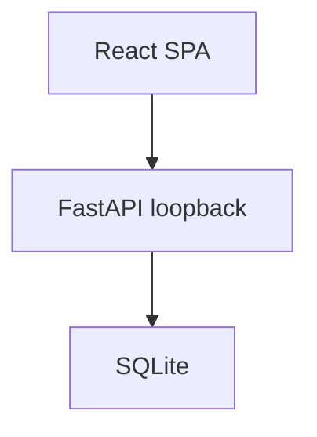

# Architecture

## High-Level Structure

```
ViralClipper/
  AGENTS.md
  .cursor/skills/          agent skills
  .cursor/rules/           always-apply skill rule
  backend/app/             FastAPI
  frontend/                React + Vite
  data/                    SQLite + runtime data
  media/                   account/project files (later)
  tests/
  scripts/
  docs/
```

## Data / Rendering Flow

**Specified target (full product):**
Account → Project → import video → job → transcribe → API AI candidates → threshold/rank ≤ N → FFmpeg + captions → project `clips/` folder. Deleting a source or project wipes that video, its clips, hook files, and analysis. Library lists remaining files only.

**Inspected now:**
Full Whisper transcript (cached per current `file_hash`) → Pass 1–6 → FFmpeg 1080×1920 canvas (112px hook bar + fit source into 1808px with black pad, no crop/stretch) + linear cut starting on `hook_at` + ASS captions at canvas MarginV 420 + socials stacked on the left of the fitted picture. Generate drops extra sources, verifies the file hash, and deletes previous cuts before cutting. Workbench `GET /clips?in_project=true` is empty without a current source and otherwise only lists matching `source_hash`. Clip records are created only after selection.



## Key Modules / Sections / Components
| Name | Location | Purpose | Depends on |
|---|---|---|---|
| FastAPI app | `backend/app/main.py` | HTTP API | SQLAlchemy, settings |
| Account API | `backend/app/api/accounts.py` | Social-identity CRUD | Account model |
| Project API | `backend/app/api/projects.py` | Projects under accounts | Project, Account |
| Transcription | `backend/app/services/transcription/` | faster-whisper (CPU tiny) via 3.12 sidecar | FFmpeg wav extract |
| Auto-reframe | `backend/app/services/video/reframe.py` | CPU Haar 9:16 crop via 3.12 sidecar; center fallback | FFmpeg, OpenCV in `.venv-whisper` |
| Viral AI | `backend/app/services/ai/chat.py` | OpenAI-compatible HTTP (`ChatAIProvider`); six-pass editor | Groq → Gemini → OpenRouter |
| Job API | `backend/app/api/jobs.py` | Latest job + start generate | ProcessingJob, runner |
| Usage API | `backend/app/api/usage.py` | Recorded Groq/Gemini/OpenRouter calls | `ApiUsageEvent`, `usage.py` |
| API monitor | `frontend/src/pages/UsagePage.tsx`, `ApiMonitor.tsx` | All vs one provider, charts, live call | `GET /api/usage` |
| Project workbench | `frontend/src/pages/ProjectDetailPage.tsx` | Drop, options bar, selectable clips, Watch API dock | API client |
| Library | `frontend/src/pages/LibraryPage.tsx` | Search/filter/tag ready clips | `GET /api/clips`, `GET /api/tags` |
| App shell | `frontend/src/layouts` | Left sidebar; project pages fill remaining width | Router |

## Conventions in Use
- Python type hints, Pydantic schemas for API I/O
- SQLite integer PKs; media paths as strings
- API prefix `/api` except `/health`
- Frontend fetches `/api/...` via Vite proxy in dev; desktop serves `frontend/dist` from FastAPI on port 8000
- Desktop launcher: `scripts/desktop_app.py` (Edge `--app`, separate profile under `data/desktop-profile`)

## Known Technical Debt
- `python` command missing; scripts must use `py -3`
- Haar reframe still exists for tests; Generate letterboxes with `crop=None`
- Branding TestClient collection can fail on some httpx/starlette versions (`app=` kwarg)
